# ElderCaringApp — 독거노인 건강 모니터링 시스템

> 독거노인의 일상 (앉기·심박·움직임·화장실 사용) 을 **로드셀(HX711) + MAX30102 심박 + MPU-6050 자이로 + HC-SR501 PIR 4 개 센서를 동시에 묶어** 측정하고, 보호자가 *떨어져 있어도 가까이 있는 것처럼* 상태를 실시간으로 확인할 수 있게 만들어 본 학부 팀 프로젝트입니다. 2024-2 학기 의료IT공학과 *"설계 및 프로젝트 기본 II"* 의 **재설계 단계** — 같은 학기 같은 과목의 [SchoolbusRFID](https://github.com/MoriochoRadio/SchoolbusRFID) (역설계) 다음에 진행한 4 인 팀 프로젝트입니다.

     

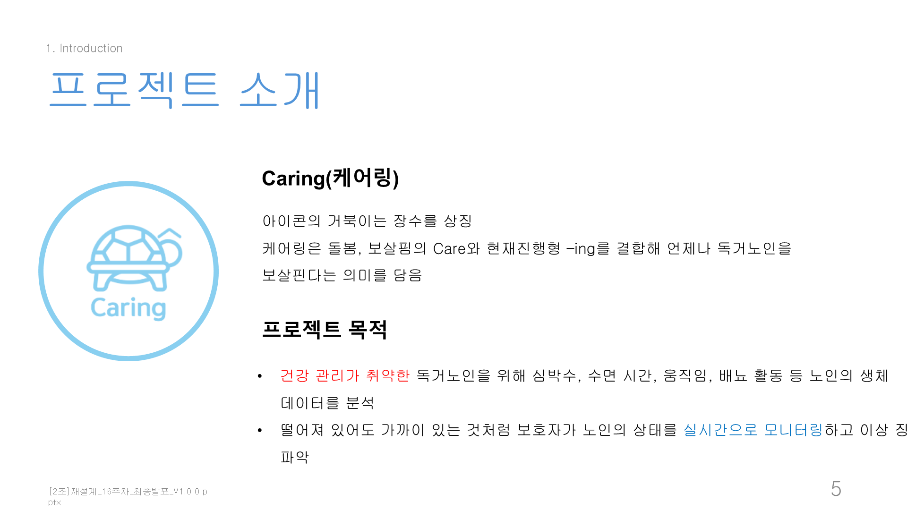

> 발표 슬라이드의 프로젝트 소개 — **Caring(케어링)** = 케어 + 현재진행형 *-ing*. 거북이 아이콘은 장수의 상징.

---

## ⚠ 빌드 상태에 관하여

본 레포는 **2024년 12월 시연 시점의 코드를 그대로 보존**합니다. 자매 프로젝트 [`MedQueue`](https://github.com/MoriochoRadio/MedQueue) (Xamarin 지원 종료로 빌드 불가) 와 달리, ElderCaringApp 은 형제 프로젝트 [`SchoolbusRFID`](https://github.com/MoriochoRadio/SchoolbusRFID) 와 동일한 2024 년 신규 스택 (Gradle, AGP 8.6+, Android Java compileSdk 34, Firebase 21.x, ESP32 Arduino) 으로 작성되어 작성 시점에는 빌드 가능했습니다.

다만 향후 빌드 가능성은 다음 이유로 변할 수 있습니다:
- Firebase 의존성 22+ 마이그레이션 권장
- ESP32 보드 패키지 / HX711 라이브러리 API 변경
- Android SDK 의 deprecation 정책

코드 안의 모든 시크릿 (Firebase Auth Secret 2 종, WiFi 자격증명 4 쌍, Google Maps API 키, 두 `google-services.json`) 은 마스킹된 더미로 치환되었으며, 두 Firebase 프로젝트 (`monitoring-a6b20`, `wearable-e1302`) 의 인증 정보는 콘솔에서 회수·무력화되었습니다. 직접 빌드해보려면 [`src/android/`](src/android/) 의 `google-services.json.example`, [`src/firmware/*.ino`](src/firmware/) 의 WiFi/Firebase 자리를 본인 환경 값으로 채워 넣어야 합니다.

---

## 📚 프로젝트 컨텍스트

| 항목 | 내용 |
|---|---|
| **시기** | 2024학년도 2학기 (개발 기간: 2024.08.26 ~ 2024.12.13, 약 4 개월) |
| **소속** | 건양대학교 의료IT공학과 |
| **과목** | 설계 및 프로젝트 기본 II (★ **재설계** 단계 — 같은 학기 [SchoolbusRFID 역설계](https://github.com/MoriochoRadio/SchoolbusRFID) 다음) |
| **지도교수** | ◯◯◯ · ◯◯◯ 교수님 |
| **팀** | 2조 케어링(Caring) — 4 인 (PM ◯◯◯ · QA ◯◯◯ · CM ◯◯◯ · **ENG 김태경 (본인)**) |
| **본인 (KimTaeKyoung) 역할** | **ENG — 로드셀 (HX711) 하드웨어 메인 + Android 앱 4 통계 화면 (심박/수면/움직임/화장실) UI+백엔드 + 소프트웨어 코드 관리 + 중간·최종 발표** |
| **HW 본인 메인** | 로드셀 (SEN-10245 + HX711 24-bit ADC) 회로 설계 + 펌웨어 (`src/firmware/Loadcell.v.*.ino`) + 외형 케이스 |
| **SW 본인 메인** | `activity_heart_rate_statistics.java` (675 줄), `activity_movement_statistics.java` (678 줄), `activity_sleep_time_statistics.java` (748 줄), `UserActivity.java`, 4 화면 UI/XML 레이아웃 |
| **공동 담당** | 메인 화면, 로그인/회원가입, 화장실/전체 통계, Cloud Functions, Firebase 연동 |

---

## ❓ 문제 정의

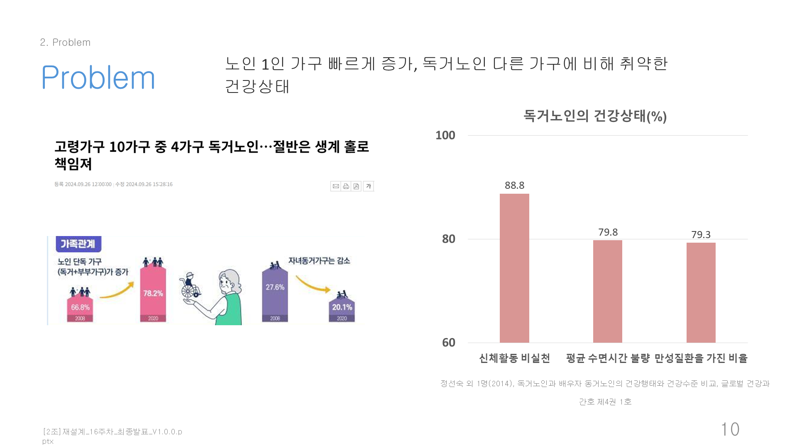

> *"노인 1인 가구가 빠르게 증가하고 있고, 독거노인의 건강 관리는 보호자가 가까이 없어 취약합니다."*

대한민국에서 노인 1인 가구는 빠르게 증가하고 있고, 보호자가 멀리 떨어져 살고 있어 *"부모님이 지금 어떤 상태인지"* 를 실시간으로 알기 어렵습니다. 갑작스러운 심박 이상, 깊은 수면 부족, 움직임이 없는 시간이 길어지는 것 등이 발견됐을 때는 이미 늦은 경우가 많습니다.

본 프로젝트는 이 문제를 *"4 개 센서로 일상의 4 가지 단면 (심박·수면·움직임·화장실) 을 동시에 측정하고 보호자에게 실시간으로 공유"* 하는 시스템으로 풀어보려 했습니다.

---

## 💡 솔루션

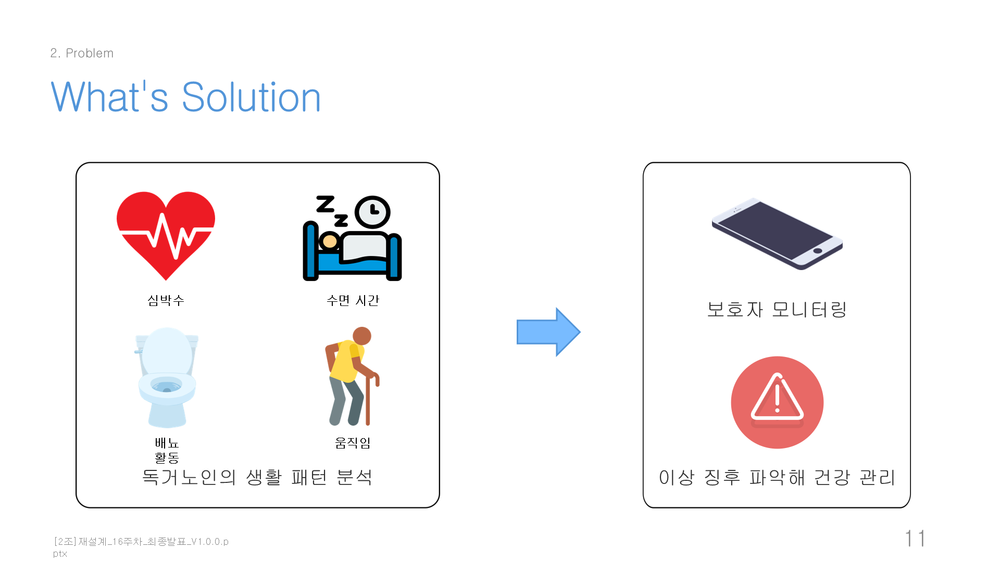

> **"보호자 모니터링 — 이상 징후를 파악해 건강 관리. 독거노인의 생활 패턴 분석: 심박수 · 수면 시간 · 움직임 · 배뇨 활동"**

### 시장조사를 거쳐 도달한 결론

| | 터치케어 | 갤럭시워치/애플워치 | **Caring (본 프로젝트)** |
|---|---|---|---|
| **장점** | 노인 친화 UI | 정확한 생체 측정 | 두 장점의 결합 |
| **단점** | 측정 정확도 한정 | 노인 친화 X (착용·UI 어려움) | — |

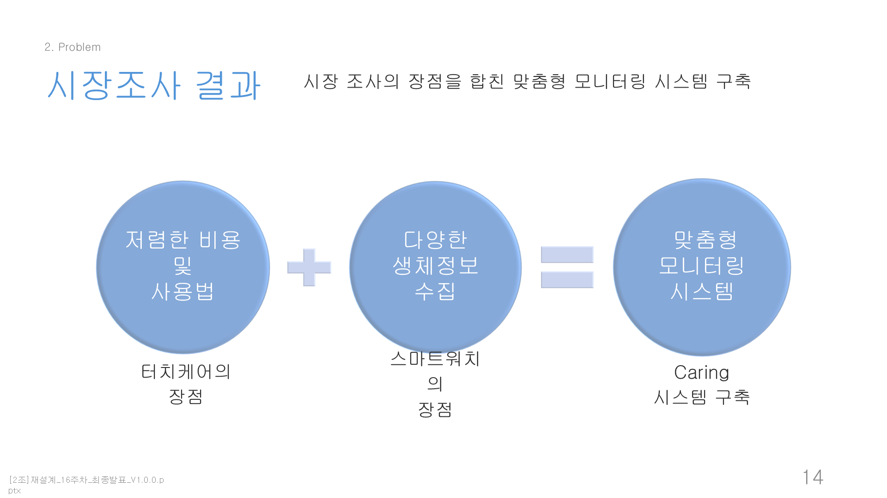

→ *"터치케어의 장점 + 스마트워치의 장점을 합친 맞춤형 모니터링 시스템 구축"* 이 본 프로젝트의 핵심 전략. 노인이 *추가로 무언가를 착용·조작해야 하는 부담* 없이 일상에서 자연스럽게 측정되도록 4 센서를 분산 배치.

---

## 🛠️ 기술 스택

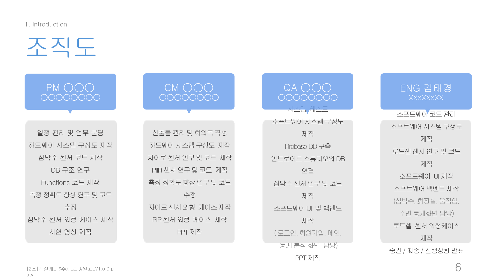

| 영역 | 기술 |
|---|---|
| **모바일** | Android Native (Java) · Gradle · AGP 8.6+ · compileSdk 34 · minSdk 24 |
| **펌웨어** | Arduino C++ · ESP32 D32 PRO (4 개 — 센서당 1 개) |
| **센서** | HX711 24-bit ADC + 로드셀 SEN-10245 (★ 본인 메인) · MAX30102 심박 · MPU-6050 자이로 · HC-SR501 PIR |
| **백엔드** | Firebase Realtime DB (×2 프로젝트 — `monitoring-a6b20`, `wearable-e1302`) · Firebase Auth · Firebase Cloud Functions (Node 18) |
| **시각화** | GraphView 4.2.2 (BarChart / LineGraph) |
| **개발 환경** | Android Studio · Arduino IDE · IntelliJ IDEA |

**주요 의존성** (`src/android/app/build.gradle`):
- `firebase-database`, `firebase-auth`, `firebase-functions`
- `com.jjoe64:graphview:4.2.2` (4 통계화면의 BarChart / LineGraph)
- 펌웨어: `HX711` (bogde), `MAX30105` (SparkFun), `MPU6050` (Electronic Cats), `FirebaseESP32` (Mobizt), `ArduinoJson`

---

## 🤔 왜 이렇게 만들었나 — 기술 선택 Q&A

**Q. 왜 이 4개 센서 조합인가?**
발표에서 정의한 독거노인 생활 패턴의 4가지 단면 — 심박수·수면·움직임·배뇨 — 에 센서를 1:1 로 대응시킨 구성입니다: MAX30102 (심박), MPU-6050 (침대 뒤척임 → 수면 깊이), HC-SR501 PIR (거주 공간 움직임), HX711 로드셀 (변기/의자 착좌 시간). 스마트워치처럼 노인이 *착용·조작해야 하는 부담* 없이, 침대·변기·거주 공간에 분산 설치해 일상에서 자연스럽게 측정되도록 한 것이 시장조사 (터치케어 vs 스마트워치) 의 결론이었습니다.

**Q. 왜 ESP32 를 센서당 1개씩 4개 썼나?**
4개 센서가 각각 다른 장소 (변기/의자·손가락·침대·거실) 에 설치되어야 해서 물리적 분산이 필요했고, 각 노드가 WiFi 로 Firebase `/LiveData` 에 독립적으로 직접 업로드하는 병렬 multi-stream 구조를 하드웨어 단위에 그대로 반영한 선택입니다.

**Q. 왜 Firebase (Realtime DB + Cloud Functions) 인가?**
별도 백엔드 서버 없이 ESP32 가 `FirebaseESP32` 라이브러리로 직접 쓰고, 앱은 리스너 구독만으로 실시간 반영됩니다. 집계는 Cloud Functions 가 `/LiveData` → `/StatsData` 로 자동 계산해, 통계 화면이 raw 신호를 매번 계산하지 않고 `/StatsData` 만 읽도록 분리했습니다. 같은 학기 [SchoolbusRFID](https://github.com/MoriochoRadio/SchoolbusRFID) 에서 검증한 Firebase 실시간 패턴의 확장이기도 합니다.

**Q. 왜 Android 네이티브 (Java) 인가?**
보호자용 앱은 Android 단일 타깃이었고, 팀의 Java 학습 기반 ([study-java](https://github.com/MoriochoRadio/study-java)) 위에서 2024년 시점의 표준 스택 (AGP 8.6+, compileSdk 34) 으로 작성했습니다. 직전 학기 [MedQueue](https://github.com/MoriochoRadio/MedQueue) 가 크로스플랫폼 프레임워크 (Xamarin.Forms) 의 공식 지원 종료로 빌드 불가가 된 것과 대비되는 지점입니다.

**Q. 15초·60-100 bpm 같은 임계값은 왜 그 값인가?**
옷이 잠시 떨어지는 오탐을 걸러내는 최소 착좌 15초, 정상 심박 60–100 bpm, 권장 수면 7–9시간 등 의학적 기준 (발표 참고문헌의 의학 논문 9건) 을 코드의 임계값으로 옮긴 것입니다. 다만 로드셀은 정량 calibration (`set_scale()`) 없이 raw ADC 값 튜닝으로 임계를 정한 학부 수준의 한계가 있고, 이 역시 아래에 그대로 기록했습니다.

---

## 🏗️ 시스템 설계

본 프로젝트의 차별 포인트는 **하드웨어 (4 센서) + 모바일 (5 통계 화면) + 클라우드 (Firebase + Functions) 의 multi-stream 풀스택** 입니다. SchoolbusRFID 의 *"RFID 단일 신호 → Android 3-role"* 패턴을 **"4 센서 multi-stream → Android 5 통계 화면 + Cloud Functions 집계"** 로 확장.

```
┌─────────────────────────────────────────────────────────────────────┐
│  4 ESP32 노드 (병렬, 노인 거주 공간에 분산 배치)                          │
├──────────────┬──────────────┬──────────────┬─────────────────────────┤
│ HX711 + 로드셀│ MAX30102 심박 │ MPU-6050 자이로│ HC-SR501 PIR              │
│   ★ 본인     │              │              │                          │
│ 변기/의자 무게│ 손가락 심박   │ 침대 뒤척임   │ 거주 공간 움직임 감지      │
└──────┬───────┴──────┬───────┴──────┬───────┴──────┬──────────────────┘
       │ WiFi         │ WiFi         │ WiFi         │ WiFi
       ▼              ▼              ▼              ▼
┌─────────────────────────────────────────────────────────────────────┐
│  Firebase Realtime DB                                                │
│  ├── /LiveData/    (실시간 raw 신호 — 모든 센서 노드가 직접 쓰기)         │
│  └── /StatsData/   (집계 데이터 — Cloud Functions 가 자동 계산)          │
└──────┬──────────────────────────────────────────────────────────────┘
       │ subscribe (Android Java)
       ▼
┌─────────────────────────────────────────────────────────────────────┐
│  Android 앱 (보호자 화면 — 5 통계 화면)                                  │
├─────────────────────────┬─────────────────────────────────────────────┤
│  ★ 심박수 통계 (본인)   │ activity_heart_rate_statistics.java (675 줄)  │
│  ★ 수면시간 통계 (본인) │ activity_sleep_time_statistics.java (748 줄)  │
│  ★ 움직임 통계 (본인)   │ activity_movement_statistics.java (678 줄)    │
│  화장실 통계 (공동)     │ activity_toilet_statistics.java               │
│  전체 통계 (공동)       │ StatisticsActivity.java                       │
└─────────────────────────┴─────────────────────────────────────────────┘
```

### System Structure (시스템 연결도)

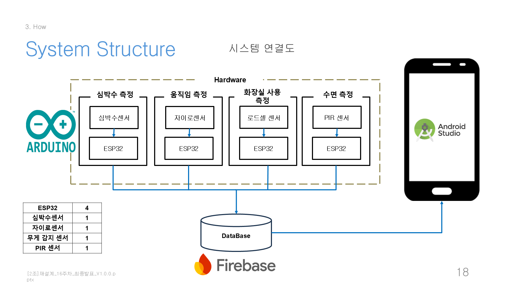

### System Architecture (5-layer)

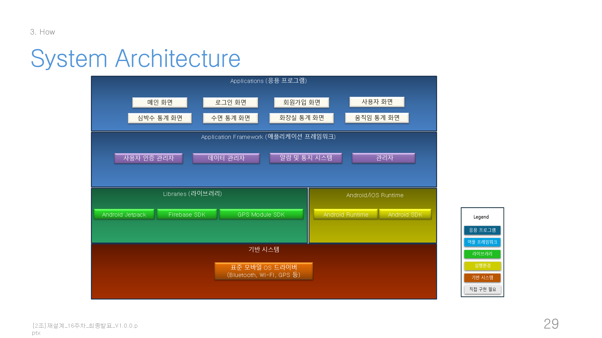

---

## ✨ 주요 기능

### 4 센서 분산 측정

| 센서 | 담당 | 측정 대상 | PNG |
|---|---|---|---|
| **HX711 + SEN-10245 로드셀** | ★ **김태경 (본인)** | 변기/의자 사용 시간 (15 초 이상 앉기 임계) | 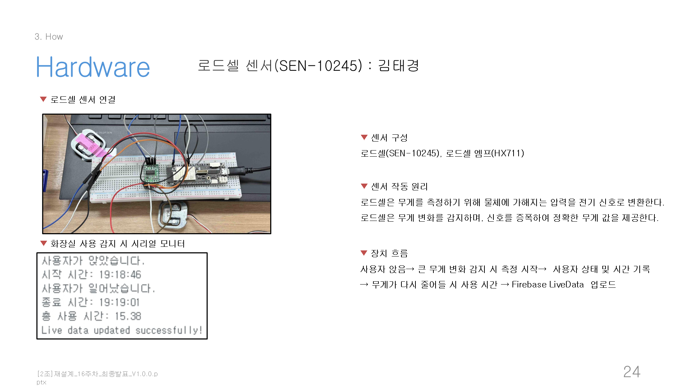 |
| MAX30102 | ◯◯◯ + ◯◯◯ (공동) | 심박수 (60-100 bpm 정상 범위) | 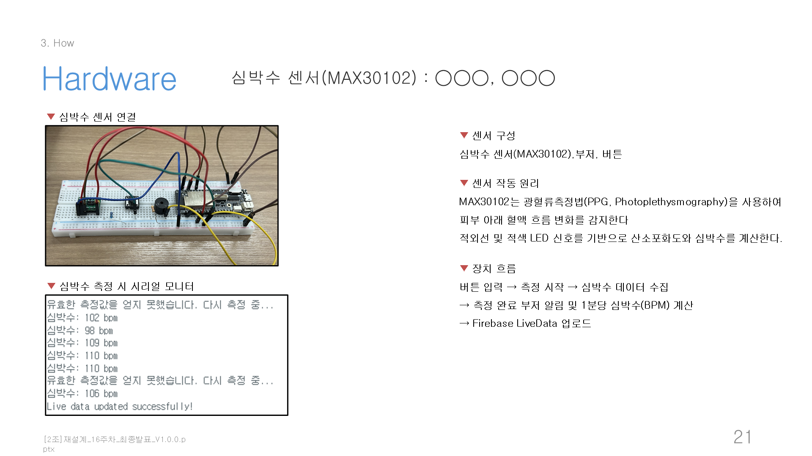 |
| MPU-6050 | ◯◯◯ | 자이로 (침대 뒤척임 → 수면 깊이) | 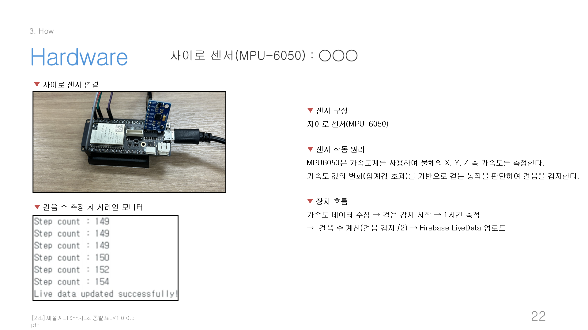 |
| HC-SR501 PIR | ◯◯◯ | 거주 공간 움직임 감지 | 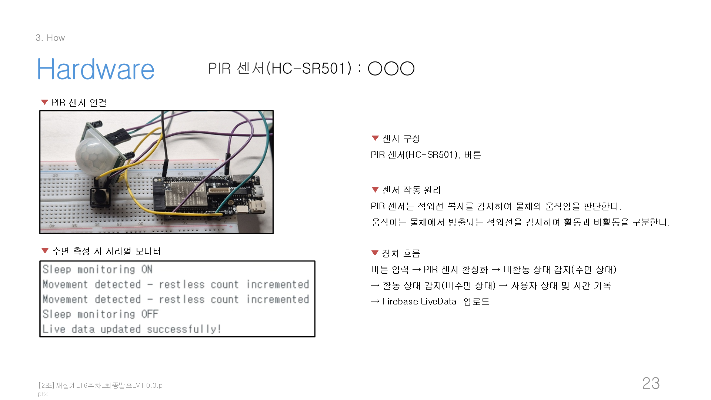 |

### 4 통계 화면 — 본인 메인 담당

각 화면은 **일/주/월/년 4 단위 시계열** 그래프 + 최고/평균/최저 수치로 구성됩니다.

| | |
|---|---|
| **심박수 통계 (본인)** | **수면시간 통계 (본인)** |
| 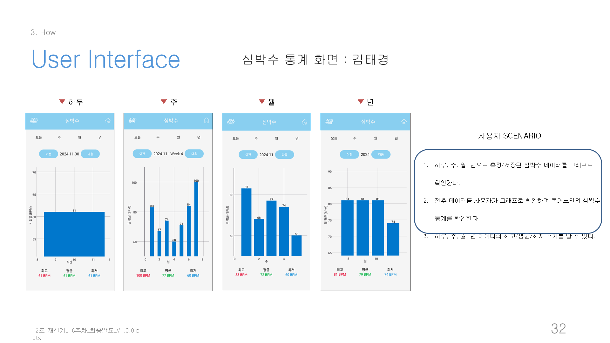 | 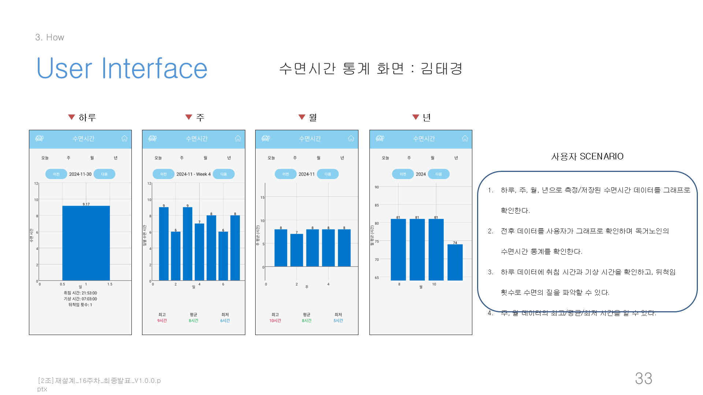 |
| **움직임 통계 (본인)** | **로그인 / 메인 (공동)** |
| 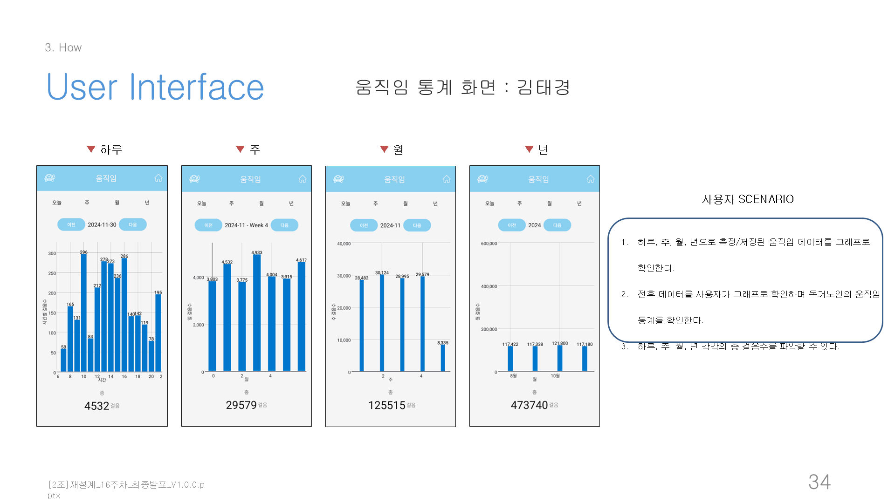 | 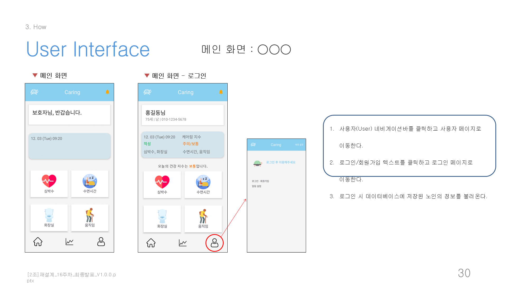 |

### 시연 영상

<video src="assets/videos/demo_video.mp4" poster="assets/videos/demo_video_poster.png" controls width="800"></video>

> 위 영상이 보이지 않으면 [`assets/videos/demo_video.mp4`](assets/videos/demo_video.mp4) 직접 재생 (24 MB, 0:53, 1280×720).

---

## 👤 본인 기여 (KimTaeKyoung · ENG)

팀 프로젝트이므로 본인이 직접 담당·작성한 부분과 공동 작업한 부분을 명확히 구분합니다.

### 1) HW 메인 — 로드셀 (HX711) 회로·펌웨어

본 프로젝트에서 본인의 핵심 영역은 **로드셀 (HX711 ADC + SEN-10245) 의 회로 설계와 펌웨어 작성** 이었습니다. 발표 자료에서 본인이 작성한 슬라이드 24 의 문장:

> *"센서 구성: 로드셀(SEN-10245), 로드셀 엠프(HX711). 센서 작동 원리: 로드셀은 무게를 측정하기 위해 물체에 가해지는 압력을 전기 신호로 변환한다. 신호를 증폭하여 정확한 무게 값을 제공. 장치 흐름: 사용자 앉음 → 큰 무게 변화 감지 시 측정 시작 → 사용자 상태 및 시간 기록 → 무게가 다시 줄어들 시 사용 시간 → Firebase LiveData 업로드."*

펌웨어는 `src/firmware/Loadcell.v.1.1.0.ino` → `Loadcell.v.1.2.0.ino` → `loadcell.v.2.0.0.ino` 의 3 메인 버전 + `_archive/` 안의 4 초기 시작 (`roadcell0.1.0.ino`, `Loadcell.V.1.1.0.ino` (대문자 V), `Loadcell0.2.0.ino`, `Loadcell1.0.0.ino`) 로 진화. 학기 초 첫 스파이크부터 시연 직전 안정 버전까지의 흔적이 그대로 보존됩니다.

### 2) SW 메인 — Android 4 통계 화면 (본인 영역)

다음 4 개 `.java` 파일의 **UI + 백엔드 로직 (Firebase 구독 / GraphView 시각화 / 시계열 집계)** 을 본인이 메인으로 담당:

```
src/android/app/src/main/java/com/example/caring01/
├── activity_heart_rate_statistics.java     ★ 675 줄 (한국어 주석 116)
├── activity_movement_statistics.java       ★ 678 줄 (한국어 주석 113)
├── activity_sleep_time_statistics.java     ★ 748 줄 (한국어 주석 142)
└── UserActivity.java                       (29 줄)
```

**공동 담당** (팀과 함께 작업): `MainActivity`, `LoginActivity`, `JoinActivity`, `StatisticsActivity` (전체 통계), `activity_toilet_statistics.java`, `ToiletUsage`/`ToiletUsageAdapter`, Cloud Functions, Firebase 초기 연동 설정.

### 3) ★ "끊임없이 수정한 통계 화면" — 데이터 증명

본 레포의 [`docs/_archive/iterations/`](docs/_archive/iterations/) 폴더에는 학기 동안의 **28 단계 코드 스냅샷** 이 보존되어 있습니다. 본인이 메인 담당한 3 화면은 **각 화면마다 학기 내내 7~11 번 다시 짰습니다**:

| 본인 파일 | 총 스냅샷 | unique MD5 변종 | 변경 횟수 | 패턴 |
|---|---|---|---|---|
| `activity_heart_rate_statistics.java` | 27 | **10** | **10 회** | 학기 내내 지속 변경 |
| `activity_movement_statistics.java` | 24 | **10** | **11 회** | ★ **가장 활발히 수정** |
| `activity_sleep_time_statistics.java` | 27 | 6 | 7 회 | 0.9.7~0.9.9.7 stable 후 마지막 4 회 집중 변경 |

본인 외 팀원이 메인 담당한 파일들과 비교하면:

| 본인 외 파일 | 패턴 |
|---|---|
| `MainActivity.java` | **18 zip 연속 stable** (28e25cd1 / 4280 B 그대로) — 초기 작성 후 거의 안 만짐 |
| `LoginActivity.java` | 21 zip 연속 stable (6067406d / 3955 B) |
| `StatisticsActivity.java` | 0.9.0 초기 stub (345 B) → 0.9.5 에서 e1e6eaae (20383 B) 로 완성 후 14 zip 동안 안정 |

> *"3 통계 화면은 학기 내내 가장 자주 손이 닿은 파일들이었습니다. heart_rate 가 10번, movement 가 11번 hash 가 바뀌었다 — 즉 각 화면을 평균 10번 다시 짰다는 뜻입니다. UI 의 사소한 픽셀 조정부터 Firebase 경로 재설계까지, 학기 내내 본인 영역만은 끊임없이 수정했습니다."*

→ 이는 자매 프로젝트 [SchoolbusRFID](https://github.com/MoriochoRadio/SchoolbusRFID) 의 *"MainActivity.java 가 5 스냅샷 모두 비트 동일 — 학기 내내 안 흔들렸다"* 와 **정반대의 본인 톤** 입니다. 같은 학기 안에서 본인의 작업 방식이 *"안 흔들리는 안정성"* 과 *"끊임없이 다듬는 집요함"* 두 가지로 나뉘어 나타났습니다.

> 시계열 진화 매트릭스 12 파일 × 28 스냅샷 전체는 [`docs/_archive/iterations/README.md`](docs/_archive/iterations/README.md) 참조.

### 4) 한국어 도메인 주석 371 줄

본인이 메인 담당한 3 통계화면에는 한국어 주석이 총 **371 줄** 들어 있습니다. 도메인 의미를 직접 풀어 쓴 흔적:

```java
// activity_heart_rate_statistics.java — Firebase 실시간 동기화 + 24시간 평균
mDatabase.child("StatsData").child(uid).child("heart_rate").child(dateStr)
    .addValueEventListener(new ValueEventListener() {
        @Override
        public void onDataChange(@NonNull DataSnapshot snapshot) {
            // 하루 24시간 동안의 심박수 데이터 수집
            for (DataSnapshot hourSnap : snapshot.getChildren()) {
                Integer bpm = hourSnap.child("avg").getValue(Integer.class);
                if (bpm != null) {
                    // 정상 범위 60~100 BPM 기준으로 색상 분기
                    int barColor = (bpm < 60 || bpm > 100) ? Color.RED : Color.BLUE;
                    series.appendData(new DataPoint(hour, bpm), false, 24);
                }
            }
            // X축 데이터 추가 (가장 위로 가지 않도록 설정)
            graph.getViewport().setMaxY(140);
        }
    });
```

```java
// activity_movement_statistics.java — 시각화 디버그 흔적
// 그래프 위에 평균선이 가장 위로 올라가지 않도록 viewport 조정
// 데이터의 최댓값보다 +20% 마진을 두고 setMaxY 설정
// (이 값을 잘못 설정하면 BarChart 의 막대 끝이 잘림)
```

```java
// activity_sleep_time_statistics.java — 도메인 임계
// 수면 시간이 5시간 미만이면 경고 색상 (빨강)
// 7시간 이상이면 양호 색상 (파랑) — 일반 성인 권장 7-9시간 기준 적용
if (sleepHours < 5.0) {
    bar.setSpacing(barColorWarning);
} else if (sleepHours >= 7.0) {
    bar.setSpacing(barColorGood);
}
```

---

## 📅 프로젝트 일정

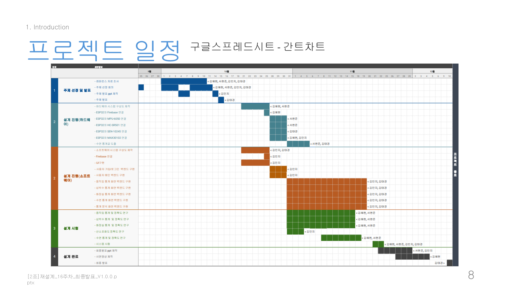

학기 일정 간트차트 — 2024.08.26 ~ 2024.12.13, 약 4 개월. 한 학기 안에 **하드웨어 (4 ESP32 + 4 센서) + 모바일 (5 통계 화면) + 클라우드 (Firebase RDB + Cloud Functions)** 의 multi-stream 시스템을 완성했습니다.

---

## 🎯 기대 효과

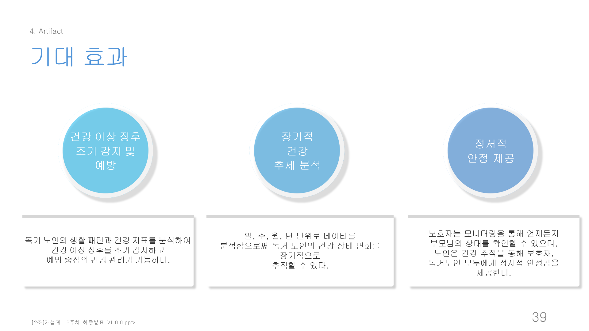

> *"건강 이상 징후 조기 감지 및 예방. 장기적 건강 추세 분석. 정서적 안정 제공 — 보호자는 모니터링을 통해 언제든지 부모님의 상태를 확인할 수 있으며, 노인은 건강 추적을 통해 보호자, 독거노인 모두에게 정서적 안정감을 제공."*

본 프로젝트가 학부 데모 단계에서 멈춘 한계와 보완점도 발표 자료에 정직하게 명시했습니다:

| 보완점 (slide 41) | 내용 |
|---|---|
| UI 노인 친화 | 글자 크기 / 색상 대비 / 단순 네비게이션 추가 필요 |
| 푸쉬 알림 | 이상 징후 발생 시 보호자 즉시 알림 미구현 |
| 전문기관 연계 | 의료기관 / 응급 서비스 직접 연계 미구현 |
| 센서 정확도 | 4 센서 raw ADC 직접 비교 — 정량 calibration 미적용 |

---

## ✍️ 본인 톤이 살아있는 코드

이 레포의 코드는 *완성된 결과 코드* 가 아니라 *학부 2학년 학생 4명이 처음 4 센서 IoT + Firebase + Cloud Functions + 4 통계 화면을 동시에 만지며 남긴 흔적* 그대로입니다. 일부러 다듬지 않은 것들:

### 1) 회로도 한 장으로 풀어낸 로드셀 임시 방편

```
<하프 브리지 로드셀 두 개와 HX711 앰프 하나를 이용해 작동시키는 임시적 대안 방법>

1. 로드셀 임시방편
하프 브리지 로드셀 두 개를 연결해 완전한 브리지 구성을 만들 때
한쪽 로드셀에만 하중을 가해야만 신호가 발생합니다.
두 로드셀에 동일한 하중을 가하면 신호가 상쇄되어 감지가 되지 않기 때문입니다.

2. 부품 구성 및 연결
로드셀 1과 2의 병렬 연결
로드셀 1의 하얀색 선과 로드셀 2의 하얀색 선을 HX711의 E+ 핀에 연결
로드셀 1의 검은색 선과 로드셀 2의 검은색 선을 HX711의 E- 핀에 연결
로드셀 1의 빨간색 선을 HX711의 A+ 핀에 연결
로드셀 2의 빨간색 선을 HX711의 A- 핀에 연결
→ 로드셀 1에 무게를 가할 때 양의 신호가, 로드셀 2에 무게를 가할 때 음의 신호가 발생

3. ESP32와 HX711 연결
HX711의 DT 핀 → ESP32의 GPIO 18
HX711의 SCK 핀 → ESP32의 GPIO 19
```
*— `src/firmware/로드셀_임시_작동법.txt` 전문*

학기 초 본인이 회로도를 한 장 그려가며 *"두 개의 하프브리지 로드셀을 하나의 HX711 으로 묶는 임시 방편"* 을 발명한 흔적입니다. *"두 로드셀에 동일한 하중을 가하면 신호가 상쇄되어 감지가 되지 않기 때문입니다"* — 이 한 줄이 도메인을 손으로 직접 배운 학부생의 사고 과정을 박제합니다.

### 2) `weightThreshold` 70 → 200 매직넘버 점프

```cpp
// src/firmware/Loadcell.v.1.1.0.ino:26   (초기)
const float weightThreshold = 70.0;

// src/firmware/Loadcell.v.1.2.0.ino:26   (중간)
const float weightThreshold = 70.0;

// src/firmware/loadcell.v.2.0.0.ino:34   (최종)
const float weightThreshold = 200.0;   // ← 70 → 200 점프!
```

위 1) 의 *두 로드셀 병렬 연결* 도입 시 신호 강도가 약 3 배가 되어 임계값을 70 → 200 으로 점프시켰습니다. **정량 calibration (`set_scale()`) 없이 매직넘버 튜닝으로 푼** 학부생의 정직한 시행착오 흔적.

### 3) `scale.set_scale()` 미호출 — raw ADC 직접 비교

```cpp
// src/firmware/loadcell.v.2.0.0.ino — set_scale() 미호출
scale.begin(LOADCELL_DOUT_PIN, LOADCELL_SCK_PIN);
scale.tare();   // 영점 보정만 함
// scale.set_scale(N.NN);   ← 정량 보정 호출 없음

// raw HX711 ADC 값을 매직넘버 (200) 와 직접 비교
float currentWeight = scale.get_units(10);
if (currentWeight > weightThreshold) { ... }
```

영점 보정 (`tare`) 만 하고 정량 보정 (`set_scale`) 은 한 번도 안 했습니다. raw HX711 ADC 값을 매직넘버 (70, 200) 와 직접 비교하는 *"동작하면 OK"* 학부생 패턴이 7 개 `.ino` 모두에 일관됩니다.

### 4) 15 초 `minSitDuration` — 노인 케어 도메인 임계

```cpp
// src/firmware/loadcell.v.2.0.0.ino:35
const unsigned long minSitDuration = 15000; // 최소 15초 동안 앉아있어야 함 (밀리초)
...
if (sittingDuration >= minSitDuration) {
    int sdSeconds = sittingDuration / 1000;
    ...
    Serial.println("사용자가 일어났습니다.");
}
```

*"옷이 잠시 떨어진 경우 등은 화장실 사용으로 인정 안 함"* — 노인 케어 도메인을 직접 사고한 흔적. **15 초** 라는 숫자에 *"이 정도면 노인이 화장실에 앉아있던 거다"* 라는 도메인 의미가 박혀있습니다.

### 5) `roadcell` 영구 타이포 + 대문자 `V` 명명

`src/firmware/_archive/` 의 명명 매트릭스:

```
roadcell0.1.0.ino           ← "loadcell" → "roadcell" 영구 타이포
Loadcell.V.1.1.0.ino        ← 대문자 V (다른 파일은 소문자 v)
Loadcell0.2.0.ino           ← 점 없음
Loadcell1.0.0.ino           ← 점 없음
```

학기 초 첫 스파이크에서 파일명 한 글자를 잘못 적었던 흔적 (`loadcell` ↔ `roadcell`). 후속 파일들에서는 정정됐지만, 이 두 파일은 학습 진정성의 증거로 그대로 보존했습니다. 같은 폴더 안에 *대문자 V* 와 *소문자 v* 가 섞여있는 명명 일관성 미숙도 함께 박제.

### 6) `JoinActivity.java` FernFlower 디컴파일 복원 흔적

```java
//
// Source code recreated from a .class file by IntelliJ IDEA
// (powered by FernFlower decompiler)
//

package com.example.caring01;
```
*— `src/android/app/src/main/java/com/example/caring01/JoinActivity.java` line 1-5*

학기 어느 시점에 `JoinActivity.java` 의 원본 `.java` 가 손실되어 `.class` bytecode 에서 IntelliJ FernFlower 디컴파일러로 복원된 흔적이 그대로 박제되어 있습니다. `iterations/caring0.9.0` 이후 24 개 zip 모두 같은 디컴파일 상태로 굳어져 있고, 시계열 archive 가 *결과만이 아니라 사고의 흔적* 까지 보존해 줍니다.

### 7) 학부 데모 단계의 정직한 sec 무지

**(a) Database rules — 무제한 r/w 가 학기 내내 유지됨**:
```json
// 학기 중 실제로 사용된 상태 (src/function-source/database.rules.json 의 학기 버전)
{ "rules": { ".read": true, ".write": true } }
```
→ 정리 시 `false / false` 로 차단했지만, 학부 데모 단계에서 누구나 두 Firebase 프로젝트의 모든 데이터를 읽고 쓸 수 있었던 흔적입니다.

**(b) `2024-2-Monitoring.json` 의 password 평문 저장**:
```json
"users": {
  "-OBZGJACYz__3vv9wojM": {
    "id": "hgd12345",
    "password": "hgd12345",      ← Firebase Auth 미사용, 평문 저장
    "phone": "01012345678"
  }
}
```
→ Firebase Authentication 같은 별도 인증 서비스를 도입하지 않고 Firebase RDB 의 `users` 노드에 직접 password 평문을 저장했던 학부생 sec 무지의 박제. 후속 캡스톤 ([seed-project](https://github.com/MoriochoRadio/seed-project)) 에서는 Firebase Auth 로 옮겨갔습니다.

### 8) `com.example.caring01` 기본 패키지명 그대로

```gradle
// src/android/app/build.gradle
namespace 'com.example.caring01'
applicationId "com.example.caring01"
```

Android Studio 의 기본 템플릿 패키지명 `com.example.*` 를 그대로 두고 시연 직전까지 안 바꾼 학부생의 정직 흔적. 실제 프로덕션이라면 `kr.ac.konyang.eldercare` 같은 패키지로 바꿔야 했지만, 학부 데모는 이런 사소한 것까지 신경 쓸 여유가 없었습니다.

---

## 📂 자료실

| 자료 | 경로 | 비고 |
|---|---|---|
| 🎤 최종 발표 자료 (51 슬라이드) | [`docs/presentation_final_redacted.pptx`](docs/presentation_final_redacted.pptx) | Git LFS 로 push (134 MB) |
| 📑 최종 보고서 (252 페이지) | [`docs/final_report_redacted.pdf`](docs/final_report_redacted.pdf) | 한컴 자동 HWP→PDF 변환 |
| 📖 본인 작성 매뉴얼 (4 개) | [`docs/manuals/`](docs/manuals/) | 로드셀 연결·설정 + 본인 3 통계화면 매뉴얼 |
| 📖 ESP32 보드 환경 설정 가이드 | [`docs/esp32_setup_guide_redacted.docx`](docs/esp32_setup_guide_redacted.docx) | 팀 작성 |
| 📊 Firebase RDB schema export | [`docs/2024-2-Monitoring.json`](docs/2024-2-Monitoring.json) | 더미 데이터만, schema 학습 자료 |
| 🎬 시연 영상 | [`assets/videos/demo_video.mp4`](assets/videos/demo_video.mp4) | 0:53 / 1280×720 |
| 📦 시계열 코드 스냅샷 (28 단계) | [`docs/_archive/iterations/`](docs/_archive/iterations/) | caring 0.9.0 ~ 0.9.9.9 (18 메인) + caring01 ~ 08 (9 병렬 브랜치) |
| 🔌 펌웨어 가이드 | [`src/firmware/README.md`](src/firmware/README.md) | HX711 핀맵 + 라이브러리 |
| ⚡ Cloud Functions | [`src/function-source/`](src/function-source/) | LiveData → StatsData 자동 집계 |

> 📌 본인을 제외한 팀원 3 명·교수 2 명의 이름은 발표 자료 본문 / 메타에서 `◯◯◯` 으로 마스킹되었습니다. 본인 외 팀원의 매뉴얼 7 개와 1.5 GB 통합 백업 zip 은 `docs/_archive/local-only/` 에 보관되어 GitHub 에는 push 되지 않습니다.

---

## 📚 참고 자료

본 프로젝트가 인용한 자료 카테고리 (전체 20 개 — 발표 자료 slide 42-46 참조):

- **노인 1인 가구·고독사 통계** (4 건) — 보건복지부·통계청
- **독거노인 의료 접근성 관련 기사·논문** (7 건) — 의료신문 / 학술지
- **심박수·수면·움직임·배뇨와 건강의 관계 근거** (9 건) — 의학 논문 (Lancet, JAMA, 한국노년학회 등)

상세 참고문헌은 발표 자료 slide 42-46 에 정리되어 있습니다.

---

## ✍️ 회고

노인 1인 가구의 증가라는 사회 문제를, *"4 개 센서로 노인 한 사람의 일상 (앉기·심박·움직임·화장실) 을 동시에 묶어 측정하고 보호자가 실시간으로 확인"* 하는 시스템으로 풀어보려 했습니다. 본인은 그 중 **로드셀 (HX711) 하드웨어 메인** 과 **Android 앱의 3 통계 화면 (심박/수면/움직임) 백엔드 + UI** 를 담당했습니다.

학기 초 회로도 한 장 그려가며 *두 개의 하프브리지 로드셀을 하나의 HX711 으로 묶는 임시 방편* 부터 시작했습니다. `weightThreshold 70 → 200` 으로 회로 바꾸며 매직넘버 튜닝까지, 정량 calibration (`set_scale()`) 없이 raw ADC 값으로 *"15 초 이상 앉아있어야 화장실 사용으로 인정"* 같은 도메인 임계를 직접 정했습니다. *"두 로드셀에 동일한 하중을 가하면 신호가 상쇄되어 감지가 되지 않기 때문입니다"* — 이런 한 줄이 학기 어느 시점에 본인의 노트에 적혔던 흔적이 그대로 [`src/firmware/로드셀_임시_작동법.txt`](src/firmware/로드셀_임시_작동법.txt) 에 남아있습니다.

같은 학기 [`SchoolbusRFID`](https://github.com/MoriochoRadio/SchoolbusRFID) 의 *역설계 단계* 에서 익힌 Firebase 실시간 동기화 + Android 3-role 패턴이 본 프로젝트의 *4-stream Firebase + 4 통계 화면 multi-subscription* 으로 확장됐습니다. SchoolbusRFID 의 *"학기 내내 비트 동일한 MainActivity (`68ce8336` / 1670 B)"* 와 정반대로, 본 프로젝트의 본인 메인 영역인 **3 통계 화면은 학기 내내 각 7~11 번 다시 짠** 끊임없는 수정의 흔적이 [`docs/_archive/iterations/`](docs/_archive/iterations/) 의 28 스냅샷에 그대로 박제되어 있습니다. *"안 흔들렸다"* 와 *"끊임없이 수정했다"* — 같은 학생이 같은 학기 안에서 두 가지 작업 방식을 모두 보여줄 수 있다는 것이 본인 포트폴리오 전체의 진화 흐름이라고 생각합니다.

또한 본 프로젝트는 본인이 의료 도메인을 직접 손으로 배운 출발점입니다. *"심박수 60-100 BPM 정상 범위"*, *"수면 7-9시간 권장"*, *"15 초 이상 앉아있어야 화장실 사용"* 같은 도메인 임계들이 코드의 매직넘버로 박혀있고, 한국어 주석 371 줄이 그 사고 과정을 보존합니다. 이 경험은 이후 [`seed-project`](https://github.com/MoriochoRadio/seed-project) 캡스톤의 팀 협업 + 의료 도메인 기반이 되었고, [`AI_Lung_1`](https://github.com/MoriochoRadio/AI_Lung_1) / [`AILungandLiver`](https://github.com/MoriochoRadio/AILungandLiver) / [`sperm-ai`](https://github.com/MoriochoRadio/sperm-ai) 의 의료 + AI 도메인으로 확장되었습니다.

학부 데모 단계의 sec 무지 — `database.rules.json` 의 무제한 `read/write: true`, `users` 노드의 `password` 평문 저장 — 도 정직하게 박제되어 있습니다. 학부생이 처음 Firebase 를 만지면서 *"Firebase Authentication 을 별도로 도입해야 한다"* 는 사실을 몰랐던 흔적이지만, 다음 프로젝트에서는 그것을 알고 옮겨갔다는 학습 흐름 자체를 자료로 남기는 게 가치 있다고 봅니다.

같은 학기 한 과목 안에서 *어린이 단일 RFID 신호 (역설계)* → *노인 4 센서 복합 신호 (재설계)* 로 케어 도메인이 양 끝까지 확장된 학습 흐름의 흔적이, 이 두 레포 (SchoolbusRFID + ElderCaringApp) 의 cross-link 안에 그대로 살아있습니다.

---

## 🗂️ 관련 레포

### 본 프로젝트가 가능했던 기반 학습
- [`study-java`](https://github.com/MoriochoRadio/study-java) — Android Java OOP / 이벤트 핸들러 / 익명 클래스
- [`study-windows-programming`](https://github.com/MoriochoRadio/study-windows-programming) — Firebase Realtime DB 첫 학습 (`022_FireBase` 챕터)

### 같은 학기 같은 과목의 형제 프로젝트 (★)
- [`SchoolbusRFID`](https://github.com/MoriochoRadio/SchoolbusRFID) — *어린이 통학버스 안전* (24-2 설계 및 프로젝트 기본 II · 역설계 단계). 본인 톤이 *"학기 내내 안 흔들린 MainActivity"* 였던 자매 프로젝트.

### 같은 헬스케어·케어 도메인의 다른 프로젝트
- [`MedQueue`](https://github.com/MoriochoRadio/MedQueue) — *환자 대기 모니터링* (Xamarin.Forms · 2024-1)

### 그 이후로 이어진 의료 + AI 프로젝트
- [`AI_Lung_1`](https://github.com/MoriochoRadio/AI_Lung_1) — 폐 의료 영상 AI
- [`AILungandLiver`](https://github.com/MoriochoRadio/AILungandLiver) — 폐·간 의료 영상 AI
- [`sperm-ai`](https://github.com/MoriochoRadio/sperm-ai) — AI 정자 운동성 분석
- [`seed-project`](https://github.com/MoriochoRadio/seed-project) — Team SEED 캡스톤 (현재 진행 중)

---

## License

[`LICENSE.md`](LICENSE.md) 참조. 본 레포는 학부 팀 프로젝트의 학습 결과물을 포트폴리오 목적으로 공개한 것이며, 상업적 이용은 팀 합의가 필요합니다.

---

*Author: [MoriochoRadio](https://github.com/MoriochoRadio) (KimTaeKyoung) · 건양대학교 의료IT공학과*
